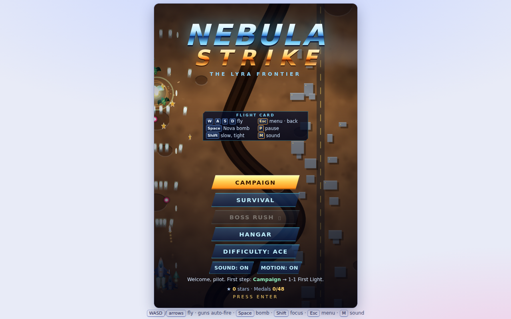
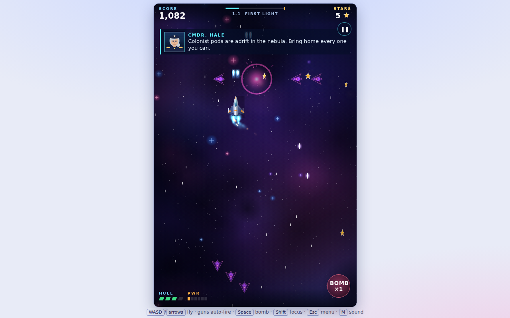
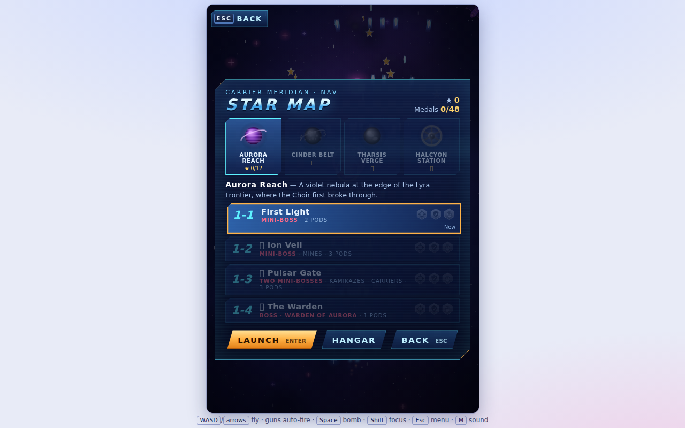
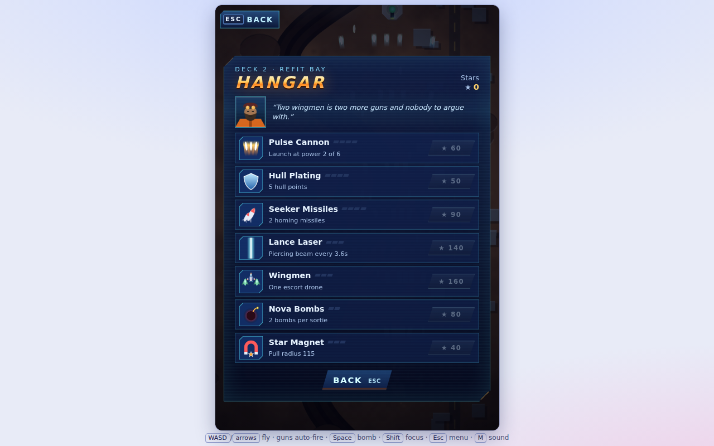
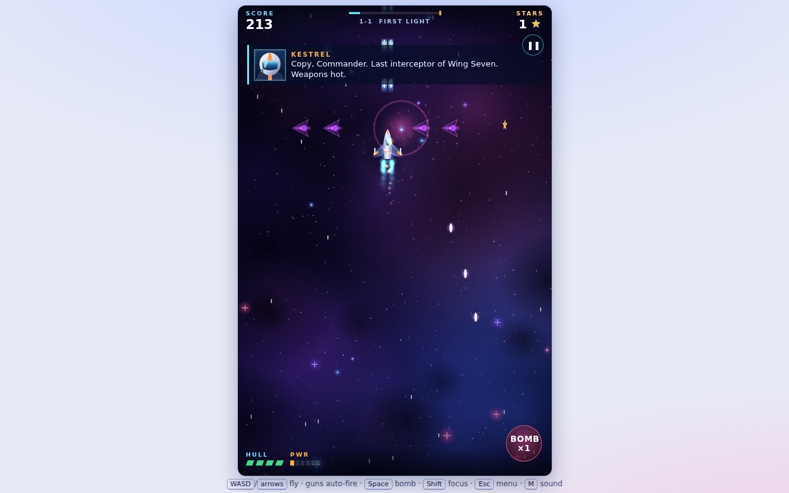
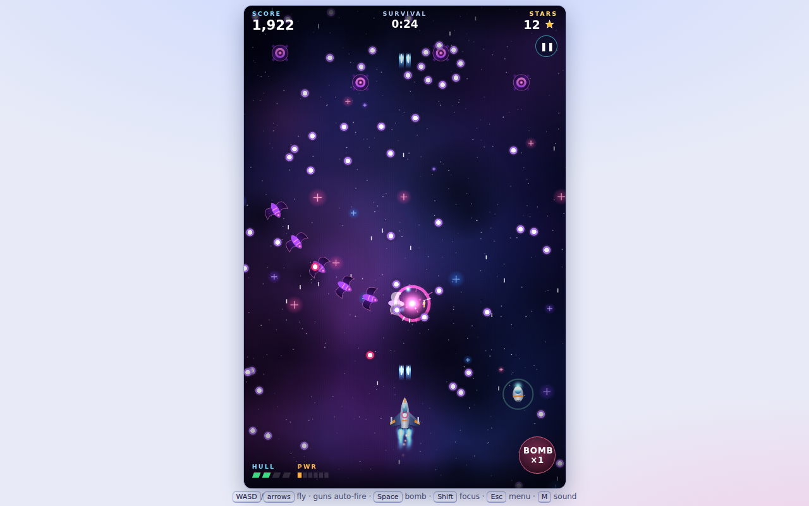

# Nebula Strike

**Four star systems, multi-phase bosses, medals and a hangar to upgrade.**

<p align="center">
  
</p>

<p align="center">
  <a href="https://ai-llm-2030.github.io/TrueMarch_Games_Nebula_Strike/"><b>▶ Play Nebula Strike in your browser</b></a>
</p>

## Gameplay

<p align="center">
  
</p>

## More screenshots

<table>
<tr><td width="50%"><br><sub>The star map</sub></td><td width="50%"><br><sub>The Hangar: upgrades bought with stars</sub></td></tr>
<tr><td width="50%"><br><sub>Stage 1-1</sub></td><td width="50%"><br><sub>Later in the run</sub></td></tr>
</table>

## Controls

| Keys | Action |
|---|---|
| W A S D or arrows | Fly (guns fire on their own) |
| Space | Nova bomb |
| Shift | Slow, tight flying |
| Esc | Menu · back |
| P | Pause |
| M | Sound on / off |

## Run it yourself

No install, no build step, no server code, no network. The game runs entirely in your browser and keeps your progress in the browser's local storage.

```bash
git clone https://github.com/ai-llm-2030/TrueMarch_Games_Nebula_Strike.git
cd TrueMarch_Games_Nebula_Strike
python3 -m http.server 8000
# open http://localhost:8000
```

Opening `index.html` directly works too in most browsers; a local server is the most reliable way.

## What's inside

```
TrueMarch_Games_Nebula_Strike/
├── index.html        the whole game: one file, plain JavaScript and <canvas>
├── lib/
│   ├── arcade.js     shared helpers: crisp canvas, frame loop, input, theme
│   └── arcade.css    shared look
├── assets/           the pictures in this README
├── LICENSE
└── README.md
```

Written from scratch in vanilla JavaScript: every sprite, background and sound is drawn or synthesised in code (Canvas 2D and the Web Audio API). No libraries, no frameworks, no third-party assets.

## About

**Nebula Strike** is one of the 120+ games made by **[TrueMarch](https://truemarch.com)**. This repository is the standalone single-player edition of the game.

## License

© 2026 TrueMarch. All rights reserved. The source is published so you can read it, learn from it and play the game; see [LICENSE](LICENSE).
